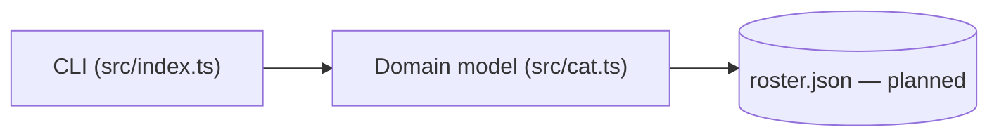
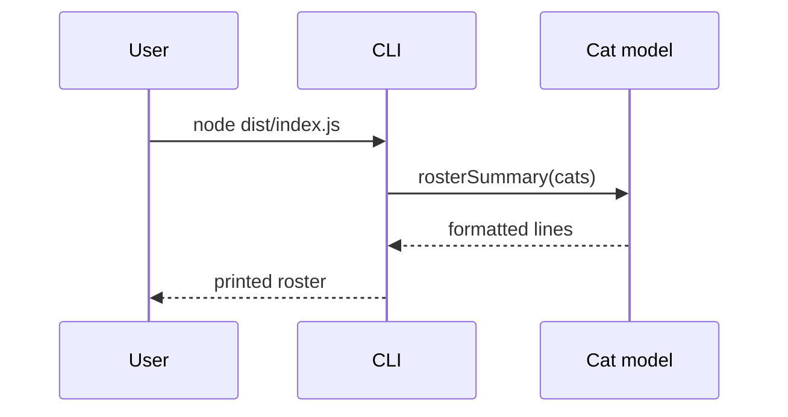

# Architecture

> Agents read this instead of scanning the whole codebase. Keep it accurate and terse.
> **Don't edit this on a feature branch.** `sync-docs` writes to `docs/changes/<branch>.md`;
> `consolidate-docs` folds those fragments in here. Check `docs/changes/` for newer impact rows.

## Overview

Cat Roster is a single-user CLI that keeps a roster of cats (name, breed,
personality, favorite activities, drama level). Today the CLI (`src/index.ts`)
prints a small sample roster from the domain model (`src/cat.ts`); the real
commands (add / list / show) and JSON persistence are planned.

## Components

## Modules

| Module | Path | Responsibility | Depends on |
| ------ | ---- | -------------- | ---------- |
| CLI entry | `src/index.ts` | Builds and prints the roster | `src/cat.ts` |
| Cat model | `src/cat.ts` | `Cat` type, `catSummary()`, `rosterSummary()` | — |
| Tests | `test/cat.test.ts` | Vitest coverage for the model | `src/cat.ts` |

## Key flows

Run the CLI:

## Change impact map

**"If you change X, also check Y."** The most important section in this file.

Add a row whenever:

- a change in one place broke something somewhere else, or
- two parts are coupled in a way that isn't obvious from imports (shared names,
  config keys, column order, file formats, env vars, etc.).

| If you change… | Also check / update… | Why | Guarded by test |
| -------------- | -------------------- | --- | --------------- |
| `Cat` fields in `src/cat.ts` | `catSummary`, `rosterSummary`, sample roster in `src/index.ts` | Summary text and samples embed field values | `test/cat.test.ts` |
| Module layout of `src/` or `test/` | `AGENTS.md` *Where things live*, `README.md` layout | Both tables mirror the layout | — |
| Package manager / test script | `AGENTS.md` *Commands*, `README.md` | Commands are duplicated in both | — |

## Data

No database. The roster is in-memory, built from a hard-coded sample; JSON file
persistence (`data/roster.json`) is planned. The schema lives with the `Cat`
type in `src/cat.ts`.