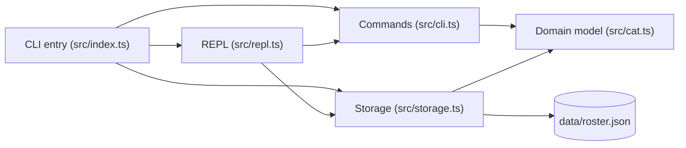
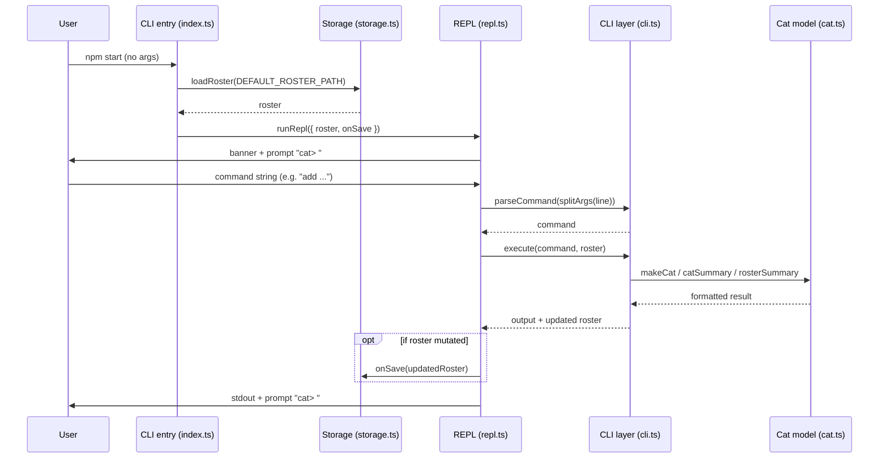
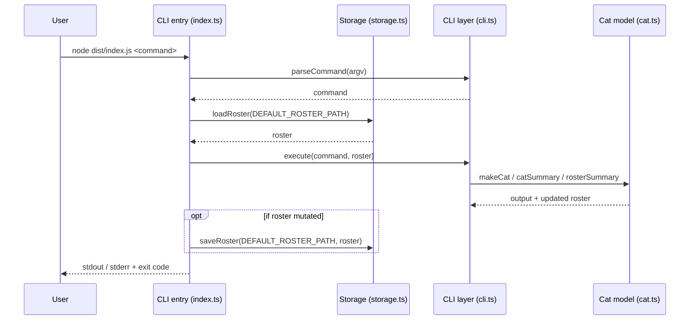

# Architecture

> Agents read this instead of scanning the whole codebase. Keep it accurate and terse.
> **Don't edit this on a feature branch.** `sync-docs` writes to `docs/changes/<branch>.md`;
> `consolidate-docs` folds those fragments in here. Check `docs/changes/` for newer impact rows.

## Overview

Cat Roster is a single-user CLI that keeps a roster of cats (name, breed,
personality, favorite activities, drama level). The CLI entry (`src/index.ts`)
launches an interactive REPL (`src/repl.ts`) when called with no arguments, or
dispatches parsed commands from `src/cli.ts` in one-shot mode. Both modes load
and persist data to `data/roster.json` via `src/storage.ts` using the domain
model (`src/cat.ts`). Commands: `add` / `list` / `show` / `help`.

## Components

## Modules

| Module | Path | Responsibility | Depends on |
| ------ | ---- | -------------- | ---------- |
| CLI entry | `src/index.ts` | Dispatches to REPL (no args) or one-shot commands, orchestrates storage | `src/cli.ts`, `src/repl.ts`, `src/storage.ts` |
| REPL session | `src/repl.ts` | Interactive session, prompt `cat>`, tokenizes args, auto-saves on mutation | `src/cli.ts`, `src/cat.ts` |
| Storage layer | `src/storage.ts` | Loads and saves `data/roster.json`, validates cats via `makeCat` | `src/cat.ts` |
| CLI layer | `src/cli.ts` | `parseCommand`, `execute`; `add`/`list`/`show`/`help` | `src/cat.ts` |
| Cat model | `src/cat.ts` | `Cat`, `makeCat`, `parseDramaLevel`, `formatDrama`, `catSummary`, `rosterSummary` | — |
| Tests | `test/cat.test.ts`, `test/cli.test.ts`, `test/storage.test.ts`, `test/repl.test.ts` | Vitest coverage for model, CLI, storage, and REPL | `src/cat.ts`, `src/cli.ts`, `src/storage.ts`, `src/repl.ts` |

## Key flows

### Interactive REPL

### One-shot CLI

## Change impact map

**"If you change X, also check Y."** The most important section in this file.

Add a row whenever:

- a change in one place broke something somewhere else, or
- two parts are coupled in a way that isn't obvious from imports (shared names,
  config keys, column order, file formats, env vars, etc.).

| If you change… | Also check / update… | Why | Guarded by test |
| -------------- | -------------------- | --- | --------------- |
| `makeCat` validation rules | `loadRoster` (stored cats are validated on load) | A stricter rule can brick existing rosters | `test/storage.test.ts` |
| Roster file format (`Cat` fields) | `data/roster.json`, README Usage | The file format mirrors the `Cat` type | `test/storage.test.ts` |
| REPL commands / prompts / startup banner | `npm start` behavior, README Usage | Interactive and one-shot share `parseCommand` | `test/repl.test.ts` |
| `catSummary` / `rosterSummary` layout | `test/cat.test.ts`, `test/cli.test.ts` | Output contains emoji masks and multi-line formatting | `test/cat.test.ts`, `test/cli.test.ts` |
| `Cat` fields in `src/cat.ts` | `catSummary`, `rosterSummary`, sample roster in `notes/cats.ts` | Summary text and samples embed field values | `test/cat.test.ts` |
| Module layout of `src/` or `test/` | `AGENTS.md` *Where things live*, `README.md` layout | Both tables mirror the layout | — |
| Package manager / test script | `AGENTS.md` *Commands*, `README.md` | Commands are duplicated in both | — |
| `Cat` fields / `makeCat` validation | `cli.ts` `parseAdd`, help text, README Usage examples | CLI builds cats from raw strings | `test/cli.test.ts` |
| CLI command set | `src/index.ts` dispatcher, help text, README Usage | A command surfaces in three places | `test/cli.test.ts` |

## Data

No database. The roster persists to `data/roster.json` (CWD-relative) as a JSON
array of `Cat` objects. `loadRoster` validates every cat via `makeCat` on load to
prevent silent corruption. `data/roster.json` is gitignored so user data remains
local. The schema lives with the `Cat` type in `src/cat.ts`.